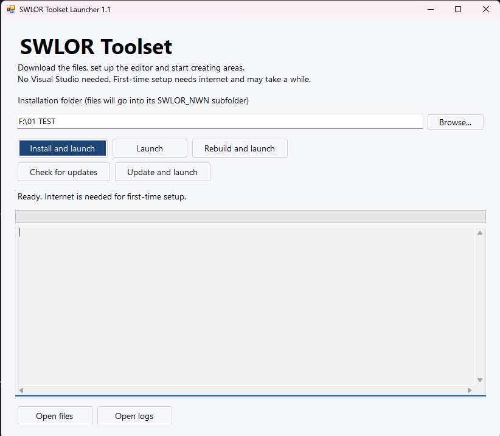
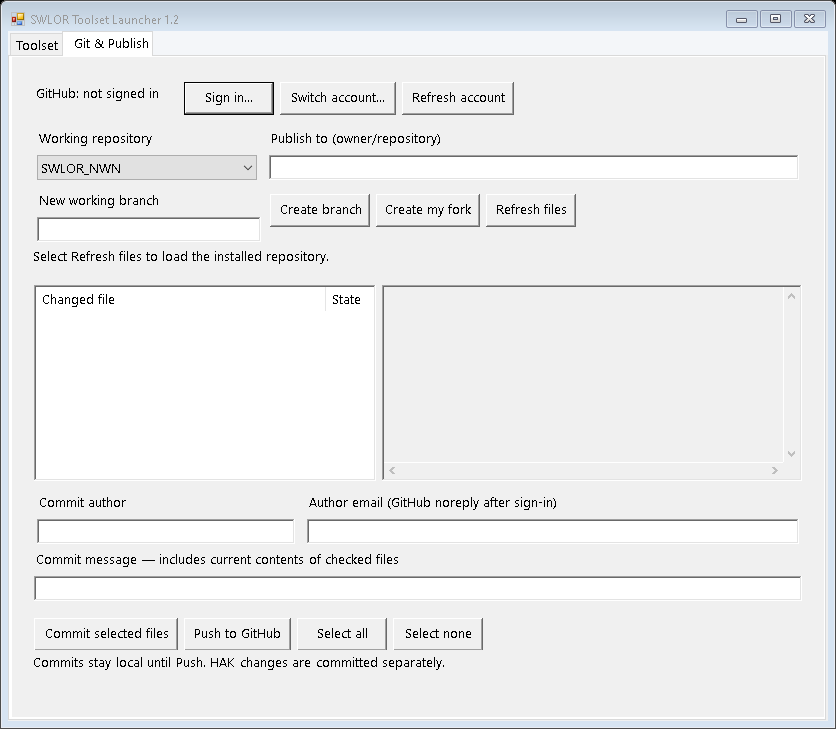

# Toolset SWLOR

An independent, unofficial Windows launcher for the SWLOR desktop Toolset, with an English interface. Version 1.2 helps you install the required tools, build the desktop application, launch it, and apply guarded updates.

This repository is maintained independently by Antras89. It is not an official SWLOR release or a fork of the SWLOR repositories. The launcher downloads the official SWLOR_NWN repository and its pinned SWLOR_Haks assets when installing the Toolset.

## Download and start

1. Download [SWLOR-Toolset1.2.zip](SWLOR-Toolset1.2.zip) and extract it.
2. Open `SWLOR-Launcher.exe` without administrator privileges.
3. Select a writable installation folder and click **Install and launch**.
4. Once the Toolset opens, use **Tools > Area Generator** to create an area.

The ZIP contains the ready-to-run launcher, source code, instructions, and validation notes.

## Features

- Install Git when needed and a private .NET 10 SDK.
- Download the Toolset source and the HAK revision pinned by that source.
- Build and launch the desktop Toolset and configure its Module Root.
- Launch an existing build without downloading or rebuilding.
- Rebuild local source without fetching updates.
- Check for upstream updates and preview incoming commits.
- Apply guarded fast-forward updates; local changes and diverged history block updating.
- Open local project files and diagnostic logs from the launcher.

Saving areas changes local files. Git & Publish sends commits to GitHub only when you click Push and confirm the destination. It does not deploy a live server.

## Git & Publish

1. Open the **Git & Publish** tab and click **Sign in**. The launcher obtains GitHub CLI if needed, verifies its download, and opens its interactive browser login flow. Follow the code shown in the login window.
2. Use **Switch account** for a username previously signed in through this launcher, or **Sign in** to add another account. **Refresh account** restores the active account details after restarting.
3. Select **SWLOR_NWN** or **SWLOR_Haks**. Enter your publishing destination as `owner/repository`. Use **Create my fork** if you need your own fork; the upstream `origin` remains unchanged.
4. Create a working branch, then click **Refresh files**. Check the files to include and click a file to preview its changes.
5. Check the commit author and email, enter a message, and click **Commit selected files**. The commit includes the current contents of those files; unrelated staged changes remain staged.
6. Click **Push to GitHub** and review the account, destination, branch and commit. Push sends all local commits on that branch, not unchecked or uncommitted working files.

For HAK work, commit and push the HAK repository first. Then select SWLOR_NWN and commit its updated HAK reference. Initial HAK checkouts use detached HEAD; create a branch before committing. Unresolved merges and dirty submodule references are blocked. Large or binary files may show a summary instead of a text preview.

Account selection uses a launcher-specific GitHub CLI configuration in `%LOCALAPPDATA%\SWLORLauncher\github-auth`. Credential storage and browser authentication are managed by GitHub CLI. The launcher does not ask for or log a token. The selected account's GitHub noreply address is offered as the commit email; you can edit the author fields.

Working branches and local commits intentionally block the existing automatic updater when they diverge from the official source. Use a separate installation for an untouched upstream checkout, or reconcile your working branch manually. The menu never force-pushes, resets, cleans, or stashes your files. If a commit fails, its selected files may remain staged; resolve the error and retry.

## Requirements

- Windows 10 or 11, x64.
- Windows PowerShell 5.1 and .NET Framework 4.8.
- Internet access for initial setup and dependency downloads.
- A writable local installation folder and enough space for the HAK assets.

Visual Studio, a preinstalled .NET SDK, and Docker are not required. Neverwinter Nights: Enhanced Edition is optional for starting the Toolset, but is needed for base-game models and tilesets.

## Source and documentation

- [User guide](README.txt): installation, buttons, update behavior, file locations, and troubleshooting.
- [Source code](source): C# launcher, embedded PowerShell backend, build script, and tests.
- [Validation notes](VALIDATION.txt): checks recorded for the supplied version and remaining limitations.
- [Executable checksum](SHA256SUMS.txt): SHA-256 for the supplied executable.

To rebuild, use `source/Build.ps1` on Windows with the .NET Framework compiler. See the user guide for test prerequisites. The supplied executable is not commercially code-signed.

Version 1.2 passed 29 base tests, 15 update tests, 11 Git publishing tests, and a compiled UI integration test on Windows PowerShell 5.1. GitHub CLI download and SHA-256 verification were also exercised. Interactive browser sign-in and a live authenticated push through the new menu still require a manual check. The original 1.1 ZIP remains available as an archive.
